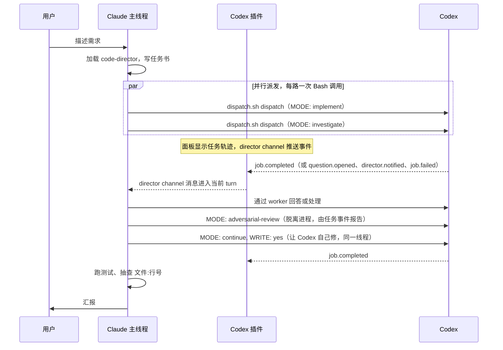

# code-director

[English](README.md) | 中文

让 Claude Code 把读代码、排查、写实现、代码 review 派给执行器 —— Codex、qodercli，或任何会说 ACP 的 agent，自己只负责跟用户对话、写任务书、判断结果。

适合的场景：你有 Claude Code 和至少一个执行器（Codex 的 ChatGPT 订阅、qodercli，或别的 ACP agent），想让 Claude 少读文件、少写代码，把上下文和输出留给判断和取舍。

## Codex 主 agent 版本

Codex 担任主 agent 时使用 [codex-director](skills/codex-director/SKILL.md)。它通过原生 `collaboration` 工具派发完整任务，在同一个 agent 上继续后续工作，通过消息接收问题与结果，并核对交付。并行写入使用独立目录，执行任务的子 agent 按任务书工作，避免递归进入调度模式。

在本 checkout 中安装：

```bash
bash ./install-codex.sh
```

安装器把 `${CODEX_HOME:-$HOME/.codex}/skills` 下的 `codex-director` 和 `codex-executor` 软链到本 checkout，遇到已有的冲突安装会保留原内容并退出。请保留 checkout 的位置。技能从下一轮 Codex 对话可用，可以用 `$codex-director` 点名，或直接描述适合委派的代码任务。宿主需要提供原生 `collaboration` 工具。这个版本直接使用这些工具，无需 app-server 或 Claude 插件；简单任务由主 agent 直接处理。

要持续按该流程路由任务，把 [docs/agents-md-snippet.md](docs/agents-md-snippet.md) 中的规则加入 `~/.codex/AGENTS.md` 或目标项目的 `AGENTS.md`。其中说明了原生派发、接续、并发与验收方式。

## Claude Code 版本：做了什么

Claude Code 版本包含一份技能、两个脚本、一份给执行任务用的 Codex 技能和一段配置：

| 文件 | 作用 |
|---|---|
| `skills/code-director/SKILL.md` | 给 Claude 主线程的工作规则：什么活派出去、任务书怎么写、并行怎么派、review 循环怎么跑 |
| `skills/code-director/scripts/dispatch.sh` | 全部派单逻辑：按 MODE 选执行器和命令、加上给执行器的调度者说明、通过插件的 `codex-companion.mjs` 启动、等待、收集；`dispatch` 一次调用启动一个任务，`follow` 阻塞跟随一个任务的事件流直到主会话需要出手，`events` 为 SDK/headless 场景输出任务事件 |
| `skills/code-director/scripts/context.sh` | 保存仓库结论，列出执行任务需要补读的规则与记忆索引 |
| `skills/codex-executor/SKILL.md` | 派出的 Codex 任务遵循的技能：工作规则、共享上下文的用法和回复格式 |
| `docs/claude-md-snippet.md` | 加进 `CLAUDE.md` 的路由规则，保证相关任务每次都走这条路 |

工作流程：



## 共享上下文

子 agent 按 `codex-executor` 技能工作，这个技能只在收到主 agent 派来的任务时加载；派单说明会点名它，非 Codex 执行器拿到它的路径自行读取。子 agent 开始排查或实现前，先运行 `context.sh rules` 并读它列出的规则文件和记忆索引，再用 `find` 查相关结论。Claude 路线从会话记录定位启动目录，拿不到路径时按会话 ID 兜底；启动信息未知时，仓库内的规则和结论仍可用。Codex 主 agent 在新任务消息里点名同一个技能。子 agent 在缺少仓库地图时存一条，引用前复核 file:line，交付前跑相关检查，回复附上保存的条目 ID 和“建议记住”。主 agent 负责记忆写入、总结、结论核实和任务间的消息转发。

结论是一条一个 Markdown 文件，放在 `<git-common-dir>/agent-context/entries/`，同一仓库的 worktree 共用，位于跟踪文件之外。条目记录 commit、文件 blob 和来源线程；文件修改或缺失时，`find` 和 `show` 标出“可能过期”。新条目默认 `unverified`，主 agent 核对证据后核实或撤回；核实只改状态，保留原始文件 hash。

在仓库中使用下列 Claude 工具路径；Codex 路线使用 `${CODEX_HOME:-$HOME/.codex}/skills/codex-director/scripts/context.sh`：

```bash
CONTEXT=~/.claude/skills/code-director/scripts/context.sh
bash "$CONTEXT" rules --from /主agent启动目录 --memory /记忆目录/MEMORY.md
bash "$CONTEXT" find --kind repo-map
bash "$CONTEXT" find 路由
bash "$CONTEXT" show <id>
printf '%s\n' '结论，附 path/to/file:line 证据。' | bash "$CONTEXT" save --kind code-path --title '路由路径' --files path/to/file
bash "$CONTEXT" verify <id>
bash "$CONTEXT" retract <id> --reason '当前证据不再支持这条结论'
bash "$CONTEXT" find --all
```

所有命令都接受 `--cwd /仓库路径`，`--files` 相对该目录解析。`rules` 的 `--from`、`--memory` 均可省略：它列出目标仓库根以上的 `CLAUDE.md`（包括兄弟 worktree 的共同上级目录，以及启动目录到仓库根之间的目录）、仓库内既没有 `AGENTS.md` 也没有 `AGENTS.override.md` 的目录里的 `CLAUDE.md`，以及存在的记忆索引。每份 `CLAUDE.md` 后紧跟其中整行 `@路径` 导入的现存文件，路径相对该文件所在目录解析，支持 `~/`；只展开一层，规则路径按顺序去重。上级目录的 `AGENTS.md` 和 `AGENTS.override.md` 仅在被导入时列出。`--source` 可覆盖自动记录的 `CODEX_THREAD_ID` 来源；保存纠正后的结论时用 `--supersedes <id>`。撤回的条目仅在 `find --all` 中显示。主 agent 派新工作前先查结论，来源线程属于当前 checkout 时优先续接；评审使用独立线程。

## 和官方 Codex 插件的关系

依赖 Claude Code 的 Codex 插件，所有对 Codex 的调用都走它的 `codex-companion.mjs` 脚本。推荐装 [y-cruce/codex-plugin-cc](https://github.com/y-cruce/codex-plugin-cc)，它是 [openai/codex-plugin-cc](https://github.com/openai/codex-plugin-cc) 的 fork，包含 `task --thread <id>`（已提交上游 [#719](https://github.com/openai/codex-plugin-cc/pull/719)）、后台任务控制、持久事件轨迹、任务面板和多执行器支持。本仓库在这些能力之上提供分工规则和派单脚本。旧的 `codex-rescue` 和 `codex-task` 转发 agent 已不再参与这套流程。

## 安装

前置条件：

1. Claude Code（验证过 2.1.259）
2. Codex CLI 已安装并登录（验证过 0.152.1）：`npm install -g @openai/codex && codex login`
3. Claude Code 的 Codex 插件，从官方插件的 fork 安装：[y-cruce/codex-plugin-cc](https://github.com/y-cruce/codex-plugin-cc)。code-director 使用其中的 `task --thread <id>`、任务面板、director channel 和实时控制。在终端执行：

   ```bash
   claude plugin uninstall codex@openai-codex   # 装过官方版才需要
   claude plugin marketplace add y-cruce/codex-plugin-cc
   claude plugin install codex@y-cruce-codex
   ```

   然后在 Claude Code 里执行 `/codex:setup` 确认状态是 ready。

安装本仓库：

```bash
git clone https://github.com/y-cruce/code-director.git
cd code-director
./install.sh
```

脚本把 `~/.claude/skills/code-director` 和派出任务要用的 `${CODEX_HOME:-$HOME/.codex}/skills/codex-executor` 软链到这个 checkout，之后的修改和 `git pull` 不用重装就生效，并删除旧版本留下的转发 agent。它还会把 Codex 插件的派单工具（`mcp__codex__dispatch`、`message`、`answer`、`result`、`status`、`tasks`、`cancel`）加进 `~/.claude/settings.json` 的 `permissions.allow`，调用时不再弹权限提示；文件里的其他内容保持不变，已经有这些规则时不做任何改动，文件不是合法 JSON 时也不碰它。checkout 不要移动或删除，否则软链会失效。然后按 `docs/claude-md-snippet.md` 把路由规则加到 `~/.claude/CLAUDE.md`，在 Claude Code 里执行 `/reload-plugins` 或重开会话。

## 使用

安装后不需要任何新命令。对 Claude 说平时的话就行：

```
这个接口偶尔返回 500，帮我查一下原因
把订单导出改成异步的，完成后发邮件通知
review 一下这个分支的改动
```

Claude 会加载 code-director，写任务书，派出去，处理插件推送的任务事件，抽查，汇报。你也可以直接点名：「用 codex 查一下 X」。

插件提供 `mcp__codex__tasks`，Claude 可以一次调用查找要继续的线程，或查看本会话正在运行的任务。它默认跨仓库列出本会话派出的线程，从新到旧显示名称、线程 ID（尚未获得时为 `pending`）、执行器、状态、最新 job 和仓库路径；排队的后续轮次合并到同一线程。可选 `query` 按名称筛选且忽略大小写，`cwd` 限定仓库，`limit` 设置条数（默认 20，范围 1–100），`all: true` 包含其他会话最近 3 天创建的任务并标出会话 ID，`days` 可用正整数扩大范围，末尾提示未显示的较早匹配数量。本会话的线程不设时间窗口。首次列表会一次性迁移旧任务，后续读取会话索引；闲置 7 天的索引会被清理，任务记录和状态目录保留。

### 任务书格式

Claude 交给 worker 脚本的内容长这样。头部几行是控制参数，空一行后是给 Codex 看的正文：

```
MODE: implement
NAME: worker 回答子命令

## Goal
...
## Context
...
## Constraints
...
## Acceptance
...
```

| MODE | 做什么 | 会不会改文件 |
|---|---|---|
| `investigate` | 读代码、追调用链、排查根因 | 不会 |
| `implement` | 按任务书写实现 | 会 |
| `continue` | 续接原执行器的线程 | 意图写在任务书；默认 full access 已允许写入 |
| `review` | 官方 review | 不会 |
| `adversarial-review` | 挑刺式 review，正文写关注点 | 不会 |

### 执行器

`EXECUTOR` 决定新任务的执行器；省略时取 `$CODEX_DIRECTOR_EXECUTOR`，没设才走 Codex。需要 Codex 时显式传 `executor: "codex"`。review 不受该默认值影响。`continue` 自动恢复原线程的执行器、ACP 命令和参数；显式指定不匹配的执行器会报错。技能仍把前端工作交给 agy；前端评审用只读 `investigate`。

旧 companion 不支持 `executor-preset` 时，continue 必须显式写原执行器；升级并重载插件后才能自动恢复。ACP 命令只在所选 companion 支持时写入调度说明，否则 dsh 把需要回答的问题写进最终回复。

| EXECUTOR | 执行者 | 额外头部 |
|---|---|---|
| `codex`（环境未配置时的默认） | 走插件 app-server 的 Codex | — |
| `qoder` | 走 ACP 的 qodercli；二进制按 PATH、`~/.qoder/entry/qoder`、`CODEX_DIRECTOR_QODER_COMMAND` 的顺序找 | `EXECUTOR_MODE`（Qoder 的会话模式，例如 `yolo`） |
| `dsh` | 走 ACP 的 DeepSeek Harness；依次查找 `EXECUTOR_COMMAND`、`CODEX_DIRECTOR_DSH_COMMAND`、可执行的 `~/.local/share/dsh-fork/dsh`、PATH 上的 `dsh` | `EXECUTOR_ARGS`、`EXECUTOR_MODE`（社区 profile 的 `default`/`plan`）、`EXECUTOR_PERMISSIONS`（默认 `allow-once`，可改为 `ask`） |
| `antigravity`（别名 `agy`） | CLI 自带的 `agy acp`；优先 `~/.local/bin/agy`，其次 PATH；用 `EXECUTOR_COMMAND` 或 `CODEX_DIRECTOR_ANTIGRAVITY_COMMAND` 覆盖 | `EXECUTOR_ARGS`、`EXECUTOR_MODE`、`EXECUTOR_PERMISSIONS`（默认 `allow-once`，可改为 `ask`） |
| `acp` | 任何在 stdio 上说 Agent Client Protocol 的 agent | `EXECUTOR_COMMAND`（必填）、`EXECUTOR_ARGS`（JSON 数组）、`EXECUTOR_MODE` |

DSH 依次查找显式 `EXECUTOR_COMMAND`、`CODEX_DIRECTOR_DSH_COMMAND`、可执行的 `~/.local/share/dsh-fork/dsh`、PATH 上的 `dsh`。独立安装是可选的，提供 fork 能力，默认参数为 `["--profile","acp-fork"]`；没装时使用 PATH 上的 dsh，默认参数为 `["--profile","acp"]`，并拒绝 `EXECUTOR_MODE`，因为旧 profile 没有会话模式。`EXECUTOR_ARGS` 优先于所选默认参数。可选安装使用 dsh `0.2.2-rc.1`、Cordis `4.1.0` 和社区插件 `@8kugames/dsh-zed-acp` `0.3.10`，位于 `~/.local/share/dsh-fork/`，启动器设置 `DSH_HOME` 为其中的 `home/`，使用 `runtime/` 内的运行时。

派单写 `EXECUTOR: dsh`；继续对话写 `MODE: continue`、`THREAD: <返回的 session id>`，自动恢复该线程记录的命令和 profile，已有 DSH 线程继续沿用旧启动配置。一轮结束后进程可退出，下次通过 `session/resume` 恢复上下文，插件保留事件历史。可选的社区适配器内置 steering、`default`/`plan` 模式、load 和 fork，companion 尚未提供任务分叉入口。steering 仍由原 prompt 响应结束回合；`message --queue` 用于下一轮，`--interrupt` 取消当前轮后执行新指令。默认只选择 `allow_once` 权限；`EXECUTOR_PERMISSIONS: ask` 把选项交给 Director。省略 `MODEL` 时保留 DSH 配置的模型。设 `CODEX_DIRECTOR_EXECUTOR=dsh` 可将它设为默认执行器。[安装与回退说明](skills/code-director/references/executors.md) 中两套 home 的会话分别管理；回退新派单时，指定原 `dsh` 程序和 `EXECUTOR_ARGS: ["--profile","acp"]`。

Antigravity 使用 CLI 自带的 `agy acp`（已验证 1.5.6），复用 CLI 登录和 MCP 配置。优先使用 `~/.local/bin/agy`，避开终端包装脚本，其次查 PATH。派单写 `EXECUTOR: antigravity`，原生工具传 `executor: "antigravity"`。`EXECUTOR_ARGS` 默认 `["acp"]`，`EXECUTOR_MODE` 可指定 `default`、`accept-edits`、`auto`、`plan`。权限默认 `allow-once`，子进程继承 companion 的网络环境。

CLI 原生读取 `~/.gemini/config/mcp_config.json`，包括 `serverUrl` HTTP 配置，无需单独的 helper 或 MCP 字段转换。

1.5.6 迁移尚未通过异步命令验收：命令未结束就可能返回 `end_turn`，1.4.4 对照会等待结束。阻断与回退详情见插件 `scripts/agy-acp/README.md`，是否切换由调度者决定。

`agy` 是 `antigravity` 的等价别名，`executor` 字段和 `EXECUTOR` 头部都接受这两种写法，也可交替续接同一会话。技能安装路径是指向本 checkout 的软链接，新开的 Claude Code 会话会读取更新后的技能。旧版插件的工具选项尚无这两个名称时，技能会通过已有的 `executor: "acp"` 调用服务，传入绝对 CLI 路径、`["acp"]` 参数和 `allow-once` 权限；Bash 的两种执行器写法也均可用。

在本 checkout 中给 Antigravity CLI 和 ACP 安装共享执行技能：

```bash
mkdir -p ~/.gemini/antigravity-cli/skills
ln -s "$PWD/skills/codex-executor" ~/.gemini/antigravity-cli/skills/codex-executor
```

目录软链接包含 `scripts/context.sh`，技能随本 checkout 更新，新建 Antigravity 会话即可发现它。

`MODEL` 指的是执行器自己的模型。Qoder 任务不写 `MODEL` 时用 Qoder 自己设置里的默认模型。Qoder 默认跑在 `yolo` 权限模式，除非 `EXECUTOR_MODE` 另行指定——派出去的任务背后没人盯着，不能卡在权限确认上。

`review` 和 `adversarial-review` 仍是 Codex 独有。ACP 用 `node "$CODEX_ACP_COMPANION_PATH" notify-director "message"` 发中途通知；agy/Qoder 用原生提问，dsh 用同一个 companion 的 `ask-director --question "问题" --options '["选项一","选项二"]'`。命令等待并输出回答，接受自由文本，取消或十分钟超时非零退出。DSH bash 设 `timeoutMs:600000`；若转后台，使用 `job_output` 收同一个 job。agy 新会话由 driver 默认使用 Carbon high / Opus medium，续接不强加默认强度。

默认 full access 下只读意图写在任务书，ACP 权限由 agent 自身模式控制。活跃 ACP queue 返回独立 job id，活跃 Codex queue 仍在原 job，闲时 queue 两者都新开 job。待答时拒绝 steer，允许 queue；ACP interrupt 保留文件但不报告 partialChanges。DSH steer 依赖扩展，周期提问提醒只在 Monitor 模式。agy 的 new/resume 把 HOME 和链接技能目录合并进文件工具范围，并通过追加系统提示指定任务 cwd。CLI 不再生成旧 workflow 技能，插件已删除对应 Git 排除规则。

必填头部：`NAME` 用几个词说明任务内容，超过 80 个字符会截断。名称显示在 dispatch/collect 输出的 `JOB:` 后；插件支持 `task --label` 时，也会显示在 status 和事件的任务 ID 旁，旧插件会输出提示并照常启动。review 命令同样传名称。

可选头部：`EFFORT`（`medium` / `high` / `xhigh` / `max`；不写时，新任务用你 Codex 配置里的 `model_reasoning_effort`，`continue` 沿用该线程上次的级别）、`MODEL`（缺省用你 Codex 配置里的模型）、`BASE`（review 类的基准分支）、`THREAD`（`continue` 必须续上的 Codex 线程）、`SIBLINGS`（一行写明其他正在跑的 Codex 任务，会给 Codex 看）、`CWD`（在哪个仓库里跑）。

### 线程连续性

Codex 的上下文窗口很大，一个线程会记住它读过的所有代码。同一个问题的后续追问放在同一个线程里，又快又准，所以技能按**一个问题一个 Codex 线程**来管：

- 每次 task 类结果都带回一行 `THREAD: <id>`。
- 同一个问题之后的所有派发（继续调查、追问、按调查结果实现、修 review 问题）都用 `MODE: continue`，头部带上这个 `THREAD:`。
- 按下一步需要的上下文选线程。调查、验证或方案得出结论后，按结论实现或做端到端验证都续那个线程，从只读转为写代码、改动别的文件也一样。任务书要让新任务去读某个线程写的报告时，直接交给那个线程；该线程还在跑，就用 `message --queue` 把下一步排给它。
- dispatch.sh 会核对请求的线程和插件即将续的线程是否一致，不一致就报 `THREAD_MISMATCH`，不会悄悄续到错的线程上。

插件支持 `task --thread <id>` 时（见 [openai/codex-plugin-cc#719](https://github.com/openai/codex-plugin-cc/pull/719)），dispatch.sh 精确续到指定线程，多个问题可以随意交错。旧版插件只能续当前 Claude 会话在这个仓库里最近一个跑完的 task 线程，dispatch.sh 会退回候选校验，Claude 也会避免在两次 `continue` 之间往这个仓库派其他 task 类任务。

### 看进度

Codex 在跑的时候，执行 `/codex:status` 能看到本仓库正在跑和最近完成的任务及当前阶段。`/codex:result <job-id>` 看某次的完整输出。只要视口停在底部，任务面板会跟随不断增长的轨迹；向上滚动后会停止跟随。任务结束后会在面板保留 3 分钟。`/codex:tasks refresh` 让面板从磁盘重建，`/codex:tasks forget <序号|名称>` 去掉其中一行；主会话在 Bash 里用 `dispatch.sh pane refresh`、`dispatch.sh pane forget <序号|名称|任务 ID>` 做同样的事，`dispatch.sh pane list` 列出每一行在面板上和磁盘上的状态。这些操作都不改任务文件。

配合支持这些功能的插件和 Claude Code 2.1.299 以上版本，待回答、失败和完成事件会使用你的通知渠道。面板里任务名和状态都可以点击；没有界面的会话会说明面板无法显示。在 `/codex:tasks`、`/codex:tasks forget` 或 `/codex:message` 的目标位置输入部分名称或 ID，按 Tab 填入对应 ID；message 只补全正在运行的任务，待回答的请求用 `/codex:answer` 处理。

### 运行中纠偏与回答

运行中补充信息或纠偏默认使用引导，在同一 job、thread、turn 中追加：调用 `/codex:message <job-id> <补充指令>`，或调用 `mcp__codex__message` 时省略 `delivery`、显式传 `delivery: "steer"`。Codex 使用原生 `turn/steer`，Qoder 使用私有 `qoder.promptQueueing`，agy 使用原生并发 `session/prompt` 并等待最新响应，DSH 的本地扩展使用 `_session/steering`；插件接入这些 ACP 能力，以任务的 `midTurnSteer: true` 为准。不要因为执行器走 ACP 就排队。`--queue` 用于明确留到下一轮执行的消息；需要立即停止当前轮再改方向时用 `--interrupt`。引导不可用或当前轮已结束时，先查状态，按意图选择后续操作；已完成的任务用 `continue` 接续。已有改动和原任务写权限会保留，已提交或已接受不代表模型已执行。返回的 Git 状态包含原有改动，不能全部归因于执行器。

自动纠偏时运行 `bash ~/.claude/skills/code-director/scripts/dispatch.sh message <job-id> <prompt-file> --cwd <repo> [--interrupt|--queue]`：成功只输出 `MESSAGED job=<id>`（`--queue` 时末尾追加 `queued=<id>`，即排队那一轮将要使用的 job id）；失败输出 `MESSAGE_FAILED job=<id> <reason>` 并以非零退出码结束；插件不支持时输出 `MESSAGE_UNSUPPORTED:`，退出码为 2。现在没有转发 agent，主会话的每条自动纠偏都直接走这条 worker 命令。两个参数是两种意图，不能同时给：当前 turn 必须停止时加 `--interrupt`；纠正可以等这一轮结束、由它开下一轮时加 `--queue`。两者对 Codex 和 ACP 执行器都可用；都不加需要执行器报告 `midTurnSteer` 能力，Codex 已支持，Qoder 通过私有 ACP promptQueueing 提供，agy 使用原生并发 prompt，DSH 可通过引导扩展声明支持。agy CLI 接入与回退步骤见插件 `scripts/agy-acp/README.md`。

同一问题的新一轮通过另一份带 `MODE: continue` 和 `THREAD:` 的任务书再次执行 `dispatch`。待答时拒绝 steer，通过 `answer` 回答；明确排到下一轮的 queue 仍可使用。

遇到结构化反问，主会话会收到 `question_opened` channel 事件，包含 request ID、问题 ID、完整问题和选项，底层 Codex 仍在等待。主会话以这些问题 ID 为键写入回答 JSON，例如 `{"<question-id>":{"answers":["..."]}}`，再执行 `/codex:answer <job-id> --request-id <id> --answers-file <绝对路径>`。已回答的 request 排除在重放之外；事件流出现 `QUESTION_PENDING` 时先查状态，再决定是否重答。默认等待回答 10 分钟，超时会中断并报告。

从 Bash 回答时，用 `dispatch.sh answer <job-id> <request-id> <answers-file> --cwd <repo>`。脚本发送前核对待回答请求、准确的问题 ID 和非空回答，发送后再次检查状态；成功输出 `ANSWERED job=<id> request=<id>`，失败输出 `ANSWER_FAILED` 和原因并以退出码 1 结束。`--cwd` 可放在 `answer` 后任意位置，缺省为当前目录；回答文件的相对路径按该目录解析。

**没有任何东西在等任务。** 主会话派发任务书后继续工作，调用在几秒内返回任务 ID 和线程。用 `claude --dangerously-load-development-channels plugin:codex@y-cruce-codex` 启动 Claude Code，启用插件的 director channel（1.4.58+，启动时需确认）。启动探针确认后，完成、提问、通知和失败通过 `<channel source="plugin:codex:director" event="..." job="...">` 消息进入当前 turn，或唤醒空闲会话。子代理派出的任务，事件送给派它的子代理。任务面板显示实时轨迹；`/codex:tasks` 打开或关闭面板，`/codex:tasks <编号或名称>` 在任务之间切换。review 类任务分离启动，任务 ID 随完成或失败事件送达。用 `result <job-id>` 读取完整结果；事件给出 `report=<path>` 时也可直接读取评审文件。

插件负责 channel 不可用时的通知回退，包括旧版任务和 ACP worker 异常退出恢复所用的 Monitor。SDK/headless 场景没有插件 hooks 时，可消费 `dispatch.sh events --cwd <仓库>`，或用 `dispatch.sh follow <job-id> --cwd <仓库>` 阻塞等待单个任务。事件流在连续一小时没有活跃任务后以 `IDLE_EXIT` 退出，下次派发前需重新启动。`events` 和 `follow` 收到未知参数时会列出支持项并以非零状态退出。

Codex 知道自己是被谁启动的。`investigate` 和 `implement` 两种模式下，worker 脚本会在任务书前面加一段固定说明：你是由调度代理启动的，不是人类；`request_user_input` 的提问由调度代理回答；同一工作区可能还有其他 Codex 任务在跑（名单来自主会话派单时的 `SIBLINGS:` 头），不要自行协调，有事告诉调度代理。插件支持 `notify_director` 工具时，Codex 还可以在不停下来的情况下给调度代理发一句话（仅限需要调度代理处理、或需要它转给其他运行中任务的事，普通进度不发），以 `director_notified` 事件送达，任务继续跑；写这句话时若有结构化反问挂起，该消息会带上 `pending_request=<id>`，提示主会话先去回答而不是发消息。Codex 任务之间不直接对话，全部由主会话中转。

选哪条 Codex 命令、review 的兜底、给 Codex 的说明都在 `skills/code-director/scripts/dispatch.sh` 里（`dispatch` 等于 `launch` 加 `collect`），脚本本身可以用 `bash -n` 和桩 companion 测试。

`status <job-id>` 可以查看待消费消息、问题、通知和中断状态。消息被接受不代表模型已经执行；原生“下一轮排队”与这里的中途纠偏不同。本次插件修改不会自动更新已安装副本；更新插件后重开 Claude 会话，使新 broker 生效。

## 设计上的几个决定

**Codex 输出不压缩。** Claude 用 `result <job-id>` 读 Codex 的结果，一字不动。省 Claude 上下文的手段只有分工本身（Claude 不读文件、不写代码），不靠截断或摘要 Codex 的回答。

**一个问题一个线程，review 只在值得时做。** 改代码类任务先派 `implement`（改动范围不清楚时先 `investigate`，再在同一线程里 `continue` 做实现）。实现回来后由 Claude 自行判断这次改动值不值得派 `adversarial-review`，审或不审都会说明。有问题让 Codex 在同一线程里用 `continue` 自己修。同一问题最多审一轮，修完用测试验证后直接收尾，不再复审。

**并行改文件使用 worktree 配合写时复制。** 主 agent 为每个写入者创建独立目录，包括主 agent 自己，并把绝对路径写进 `CWD:`。插件包含 `scripts/worktree.mjs` 时，优先使用：

```bash
bash ~/.claude/skills/code-director/scripts/dispatch.sh worktree /abs/source-repo /abs/new-worktree worker/topic
```

入口先登记独立的 Git 管理信息并固定源 HEAD，再对未修改的跟踪文件请求写时复制，在 macOS 上通过 Python 3 调用 APFS 原生 `clonefile`；源目录修改过或缺失的文件从固定提交检出。返回的 `clonedFiles`、`copiedFiles`、`checkoutFiles` 分别记录克隆、普通复制和 Git 检出数量，普通复制不代表节省磁盘。未跟踪的依赖、构建产物和会话数据不复制。创建期间保持源目录稳定。旧插件使用 `git worktree add -b worker/topic /abs/new-worktree <base-sha>`。

插件 1.4.45 起支持嵌套 Git 子模块和带检查的回收。每个子模块都有独立的 Git 管理信息和对象库，固定到父仓记录的提交；优先使用本地源子模块，否则按配置 URL 克隆。本地缺少固定提交时，即使源子模块已初始化，也会按该 URL 补取，需要正常的网络和访问权限。已有对象文件也尽可能使用写时复制，数量由 `clonedObjectFiles` / `copiedObjectFiles` 单独报告；成功返回时没有对象硬链接或 alternates 依赖。`submodules` 回执列出路径、提交、本地或远程来源及 `fetchedFromRemote`。初始化可能在主仓共享配置中补全子模块登记。访问或验证失败时保留未完成目录，不向其中派任务。判断以 Git 的 gitlink 为准，不因存在 `.gitmodules` 文件就拒绝创建。

Executor 只在分配目录工作，构建前检查符号链接和绝对路径，各自维护可写依赖与产物。先提交子模块修改，再更新主仓 gitlink，并报告需要保留的提交。主 agent 在集成完成并停止任务后，通过 `dispatch.sh worktree remove /abs/source-repo /abs/worktree` 回收目录；入口检查主仓和全部子模块，存在未提交、未跟踪或忽略文件，以及不在创建时引用和远端跟踪引用中的子模块新增提交时会拒绝删除。检查通过后才使用 Git 对已初始化子模块要求的 force 参数，保留主仓分支。面板隐藏不会回收目录；线程还需要 `continue` 时必须保留原工作树。只读源码调查可以在共享仓库按固定 SHA 读取，写文件的测试也需要隔离。

**后台启动、用事件代替等待。** task 类任务使用插件原生后台任务，`dispatch` 最多检查启动状态 10 秒，任务进入 running 且已有线程 ID，或任务已结束时提前返回。检查期间失败的任务，以及 companion 拒绝启动的派发，都返回 `STATUS: failed` 和一行 `ERROR:`；后续完成、结构化反问和通知经插件的 director channel 回到主会话。review 类任务分离启动，任务 ID 随完成或失败事件送达。

**判断逻辑写进 shell，不靠模型自觉。** review 类任务的分支模式 / 工作区模式 / 兜底三选一，写成了固定脚本，Claude 把任务书原样交给 `dispatch.sh dispatch`，别的什么都不填。

**简单任务不委托。** Claude 三次工具调用以内、不需要理解陌生代码就能做完的事（查一个值、一次 grep、已知位置改几行、跑一条命令），直接自己做；派一次 Codex 要写任务书、还要等至少一分钟。

**文档由 Claude 自己写。** 给人看的文档和页面不派给 Codex，Codex 只负责查素材。这条只约束 Claude 的分工，不写进给 Codex 的任务书，Codex 写代码时顺手改注释或 README 不去干预。

## 已知限制

- 改了 `~/.claude/skills/` 里的技能，同一会话不会立刻生效，要 `/reload-plugins` 或重开会话。
- 官方插件的 `review` 模式不接受关注点文本，只有 `adversarial-review` 接受。
- `continue` 用于上一任务结束后的续接；运行中使用 `message` 或 `answer`，不支持实时控制的旧插件仍需等任务结束。
- 插件按「Claude 会话 + 插件安装路径」各起一个共享的 Codex 运行时，它创建过的线程都被它持有写锁。换过插件安装来源之后（比如从 `codex@openai-codex` 换到 `codex@y-cruce-codex`），要重开 Claude 会话；旧安装下创建的线程在旧运行时退出前续不上。
- 只在 macOS 上验证过。脚本用 `python3` 和标准 shell 工具，Linux 应该能用，没测。

## 许可

MIT
